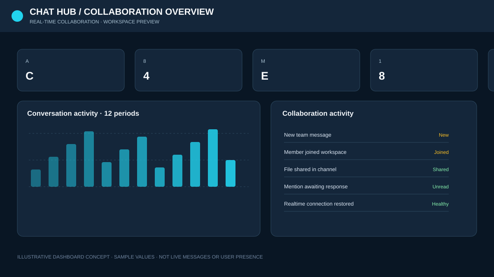
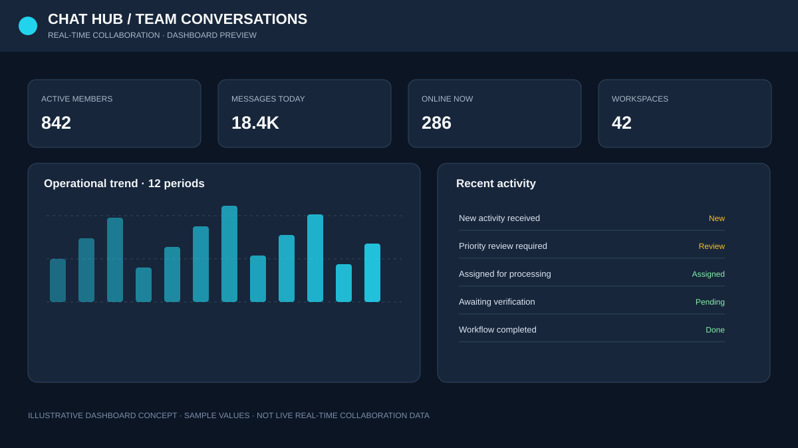
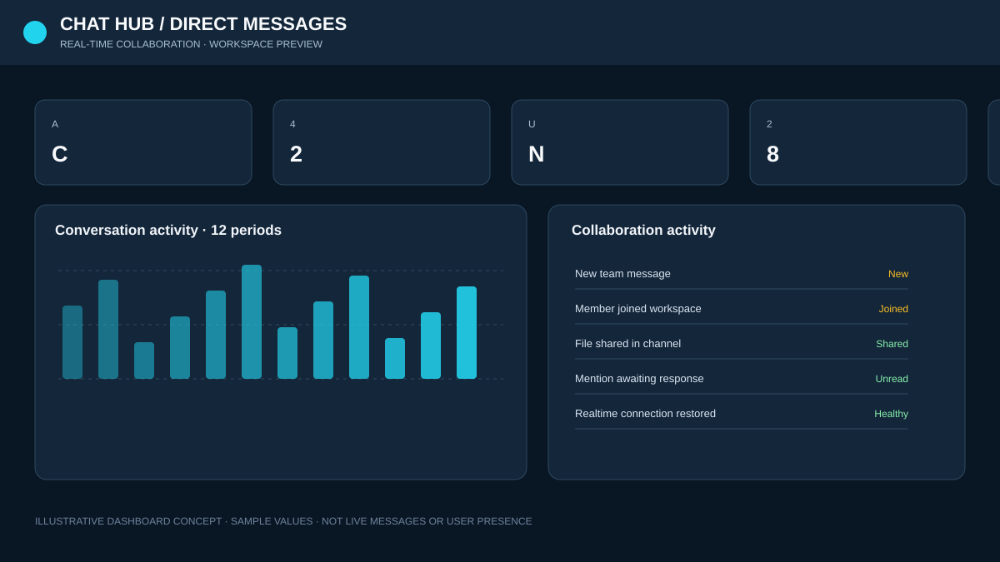
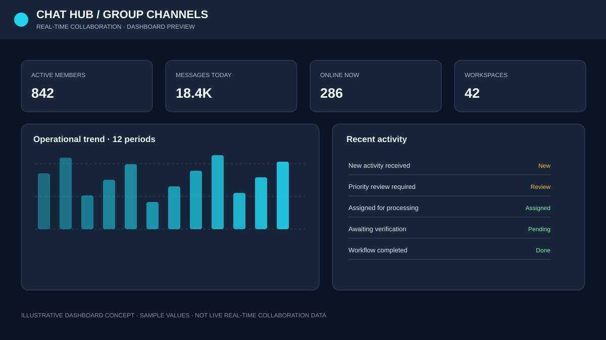
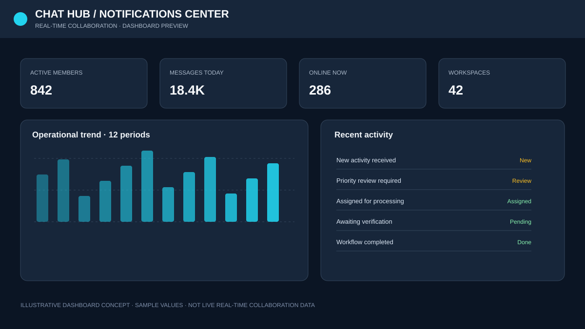
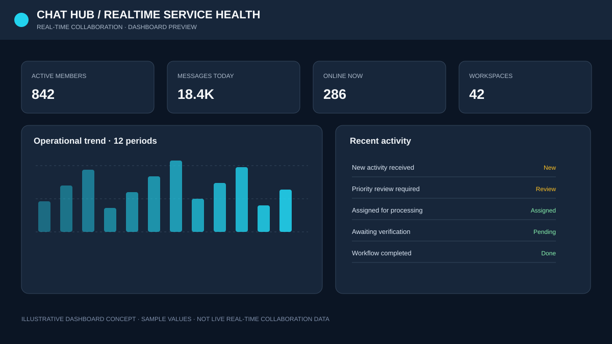
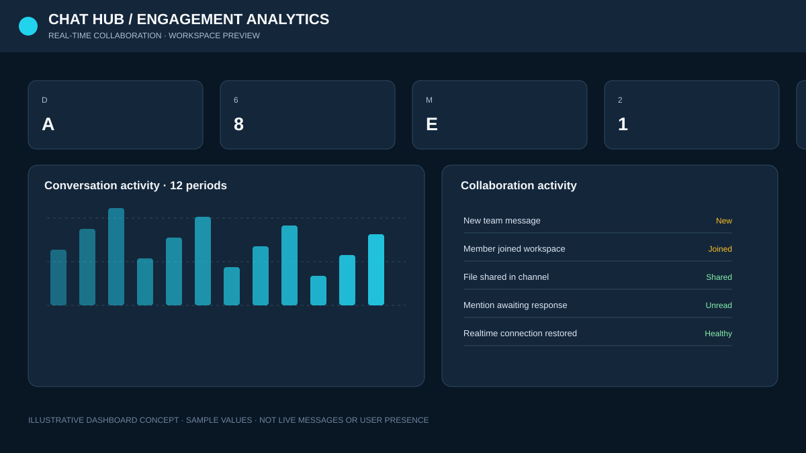

# Real-Time Chat Application

A full-stack React and Socket.IO chat prototype with MongoDB message persistence, JWT-authenticated HTTP and realtime connections, and Cloudinary image uploads.

> **Project status:** This is an evolving portfolio project, not a production messaging service. Direct conversations are scoped to their two member accounts, and HTTP / Socket.IO operations verify membership before exposing messages or events. Database-backed HTTP and realtime integration tests, deployment hardening and an independent security review are still required. Do not use real personal, confidential or sensitive message data.

## Product overview

The application demonstrates a basic authenticated realtime messaging flow:

1. A user registers or signs in with an email and password.
2. The Express API verifies credentials and issues a short-lived bearer JWT.
3. The React client stores the token in tab-scoped `sessionStorage` and validates restored sessions through the profile endpoint.
4. The user starts or opens a direct conversation with another registered username.
5. The API and Socket.IO server verify that the authenticated account belongs to the requested conversation before reading or changing its messages.
6. Messages and realtime events are delivered only to the conversation's Socket.IO room; sender identity is derived from the verified account.
7. Users can upload images to Cloudinary and delete their own messages within conversations they belong to.

## Implemented capabilities

- Account registration and login with username, email and password validation.
- Password hashing with bcryptjs; password fields are excluded from normal user queries and serialized responses.
- JWT bearer authentication for protected HTTP endpoints.
- JWT verification during the Socket.IO handshake; the sender identity is derived from the verified database user, not client-supplied message data.
- Private one-to-one conversations with a unique participant pair and membership-scoped history.
- Membership-checked image uploads and message deletion.
- Message creation, typing indicators, read-state updates and deletion notifications scoped to conversation rooms.
- Owner-checked message deletion.
- Cloudinary image uploads restricted to JPEG, PNG and WebP, with a 5 MB file-size limit.
- Bounded message history (latest 100 records), request-body size limit and validation of message content.
- Per-socket fixed-window limits for selected realtime events.
- Centralized HTTP error handling and fail-fast checks for the JWT secret and MongoDB connection.

## Architecture

```text
React client (localhost:3000)
  |
  +-- HTTP / Axios
  |     +-- Registration, login and profile
  |     +-- Authenticated message history
  |     +-- Image upload and own-message deletion
  |
  +-- Socket.IO client
        +-- JWT in handshake auth
        +-- Send / receive messages
        +-- Typing and read-state events
                  |
                  v
        Express + Socket.IO server (localhost:5000)
          +-- JWT authentication middleware
          +-- Authenticated socket handshake
          +-- Conversation, message and user models
          +-- Membership checks and per-conversation rooms
          +-- Per-socket event limiter
          +-- Cloudinary upload adapter
                  |
          +-------+--------+
          v                v
       MongoDB          Cloudinary
     users/messages      image files
```

The active server entry point is `server/index.js`. It connects to MongoDB before accepting traffic. The client uses the Create React App development proxy to reach the local API at port 5000.

## Technology stack

| Area | Technology |
|---|---|
| Frontend | React 18, Create React App |
| HTTP client | Axios |
| Realtime | Socket.IO 4 and Socket.IO Client |
| Backend | Node.js 20+, Express 5 |
| Database | MongoDB, Mongoose 8 |
| Authentication | JWT (HS256), bcryptjs |
| Media storage | Multer, Cloudinary |
| Tests | Node.js built-in test runner |

## Run locally

### Prerequisites

- Node.js 20 or later and npm.
- MongoDB instance.
- Cloudinary account and API credentials for image uploads.

### 1. Install backend dependencies

From the repository root:

```bash
npm install
```

### 2. Configure the backend

The active server calls dotenv with its default configuration, which loads `.env` from the process working directory. When you start the server from the repository root, create the root `.env` file from the maintained server example:

```bash
cp server/.env.example .env
```

Set the values in the root `.env` file:

```dotenv
PORT=5000
MONGO_URL=mongodb://127.0.0.1:27017/chat_app
JWT_SECRET=replace-with-a-unique-random-secret-at-least-32-characters
CORS_ORIGIN=http://localhost:3000
CLOUDINARY_CLOUD_NAME=your_cloud_name
CLOUDINARY_API_KEY=your_api_key
CLOUDINARY_API_SECRET=your_cloudinary_secret
```

The server exits at startup if `JWT_SECRET` is missing or shorter than 32 characters, or if `MONGO_URL` is not configured / the database connection fails. Keep credentials out of source control.

### 3. Start the backend

From the repository root:

```bash
npm run dev
```

The API and Socket.IO server listen on `http://localhost:5000`.

### 4. Install and start the frontend

In a second terminal:

```bash
cd client
npm install
npm start
```

The React development server runs at `http://localhost:3000`. Its package configuration proxies relative API requests to `http://localhost:5000`.

## Environment variables

| Variable | Required | Description |
|---|---|---|
| `PORT` | No | HTTP and Socket.IO server port; defaults to 5000 |
| `MONGO_URL` | Yes | MongoDB connection URI |
| `JWT_SECRET` | Yes | HS256 signing secret, at least 32 characters |
| `CORS_ORIGIN` | Recommended | Comma-separated browser origin allowlist; local default should be `http://localhost:3000` |
| `CLOUDINARY_CLOUD_NAME` | For image uploads | Cloudinary cloud name |
| `CLOUDINARY_API_KEY` | For image uploads | Cloudinary API key |
| `CLOUDINARY_API_SECRET` | For image uploads | Cloudinary API secret |

Configure the same allowed frontend origin in `CORS_ORIGIN` for both the Express and Socket.IO CORS policies. Do not use wildcard origins with authenticated production traffic.

## HTTP API

All protected routes require an `Authorization: Bearer <token>` header.

| Method | Endpoint | Authentication | Purpose |
|---|---|---|---|
| `POST` | `/api/auth/register` | Public | Register with username, email and 12–128 character password |
| `POST` | `/api/auth/login` | Public | Sign in and receive a 12-hour JWT |
| `GET` | `/api/auth/me` | Bearer JWT | Return the authenticated user's public profile |
| `GET` | `/api/conversations` | Bearer JWT | List only conversations for the authenticated account |
| `POST` | `/api/conversations` | Bearer JWT | Start or reopen a direct conversation by username |
| `GET` | `/api/conversations/:id/messages` | Bearer JWT | Retrieve the latest 100 messages after membership verification |
| `POST` | `/upload?conversationId=:id` | Bearer JWT | Upload an image only to a conversation the user belongs to |
| `DELETE` | `/messages/:id` | Bearer JWT | Delete the authenticated user's message after membership verification |

### Realtime events

Socket.IO clients must provide the bearer token in the handshake auth object:

```js
const socket = io("http://localhost:5000", {
  auth: { token: accessToken }
});
```

| Direction | Event | Purpose |
|---|---|---|
| Client → server | `join_conversation` | Join a room only after membership verification |
| Client → server | `leave_conversation` | Leave the selected conversation room |
| Client → server | `send_message` | Submit a conversation ID and message content; server derives sender |
| Server → room members | `receive_message` | Deliver a persisted message to that conversation only |
| Client → server | `typing`, `stop_typing` | Publish typing state for the selected conversation |
| Server → room members | `display_typing`, `stop_typing` | Notify members of that conversation only |
| Client → server | `mark_as_read` | Mark another participant's message as read within the room |
| Server → room members | `message_read` | Deliver the updated message to that conversation only |
| Server → room members | `message_deleted` | Notify members of the affected conversation only |
| Server → sender | `message_error` | Report a rejected or failed message send |

Room membership is checked against MongoDB before a socket can join, send, type or mark messages read. HTTP history, upload and delete operations apply the same participant boundary. A direct conversation is limited to its two participant accounts.

## Security model and known limitations

### Controls currently present

- Passwords are hashed with bcryptjs; the password field is excluded from normal queries and JSON serialization.
- JWTs are verified with the HS256 algorithm and a startup-validated secret.
- HTTP middleware and Socket.IO handshake both resolve the authenticated user from the token subject.
- Message sender names are taken from the verified user record.
- Message deletion is restricted to the authenticated sender.
- Message history and image uploads require authentication.
- Upload MIME types and file size are restricted; request JSON size is capped.
- Selected socket events have an in-memory per-connection rate limiter.
- CORS and Socket.IO CORS use the configured origin allowlist.

### Important gaps

- **Direct messaging only:** the current model supports one-to-one conversations, not multi-member group channels, workspace roles or invitation workflows.
- **No participant removal workflow:** membership changes and account-deletion lifecycle handling still need to be designed and tested.
- **Limited rate limiting:** selected realtime event limits are per socket and in memory. There is no shared distributed limiter or comprehensive HTTP abuse protection.
- **No automated integration suite:** current tests cover the socket event limiter, not database-backed HTTP routes, JWT lifecycle, upload integration or realtime authorization.
- **No deployment blueprint:** production hosting, TLS, secrets management, monitoring, backups and operational runbooks still need to be configured and verified.
- **No pagination/search:** message history is bounded to the latest 100 records but does not yet expose cursor pagination or search.

This project is a learning and portfolio demonstration. Do not deploy it for real users or sensitive conversations until conversation-level authorization, integration tests, operational controls and an independent security review are complete.

## Tests

Run the checked-in backend middleware tests from the repository root:

```bash
npm run test:server
```

The current test suite exercises the in-memory Socket.IO event limiter: configured event limits, window expiry, unconfigured events and counter reset. It does not currently test the HTTP API, MongoDB persistence, authentication end-to-end, Cloudinary uploads or live Socket.IO behavior.

The frontend has the standard Create React App test and build scripts:

```bash
cd client
npm test
npm run build
```

No CI workflow or production deployment configuration is documented as present in this repository. Run the checks locally before treating a change as verified.

## Roadmap

- [x] Registration and login with password hashing and JWT issuance
- [x] Protected HTTP endpoints for message history, uploads and message deletion
- [x] Authenticated Socket.IO handshake and server-derived sender identity
- [x] Owner-checked message deletion
- [x] Message validation, bounded history and upload restrictions
- [x] Per-socket limits for selected realtime events
- [x] Unit tests for the socket event limiter
- [x] Add private direct conversations and participant membership records
- [x] Scope message history, uploads, message writes, read receipts, typing and deletion events to conversation members
- [ ] Add HTTP and Socket.IO integration tests with MongoDB test fixtures
- [ ] Add pagination, message search and appropriate database indexes
- [ ] Add shared rate limiting, deployment configuration, monitoring and backup/restore guidance
- [ ] Capture genuine, sanitized application screenshots

## Maintainer

**Matiur Rahaman** · [GitHub](https://github.com/matiur25580)

---

## Dashboard gallery

The following 12 illustrations are product-concept previews for possible collaboration workspaces. They are not screenshots of implemented pages, live telemetry or real user activity.

### 01. Collaboration Overview

Workspace activity, message volume, active members and collaboration health.



### 02. Team Conversations

Channel activity, unread messages, conversation volume and engagement.



### 03. Direct Messages

One-to-one conversations, recent activity, unread items and response trends.



### 04. Group Channels

Group activity, membership, topic updates and channel participation.



### 05. Message Search & History

Search activity, history retrieval, shared links and message discovery.


### 06. File & Media Sharing

Shared files, uploads, recent media, storage and access activity.


### 07. Presence & Availability

Online presence, member availability, active sessions and status distribution.


### 08. Notifications Center

Mentions, replies, notification delivery and unread notification queues.



### 09. Moderation & Safety

Reported messages, moderation review, member restrictions and resolution.


### 10. Workspace Members & Roles

Workspace membership, role distribution, invitations and access changes.


### 11. Realtime Service Health

Socket connections, message delivery, latency and service availability.



### 12. Engagement Analytics

Conversation trends, active users, response times and workspace engagement.


